  
  
  
  
   
  
  

<!-- 2-COLUMN PIXEL INTRO & CURRENT FOCUS -->
<table>
  <tr>
    <td width="55%" valign="top">
      <h3>
        
        &nbsp;<code>whoami</code>
      </h3>
      

        Hey, I'm <b>Horizon</b> — a developer from Germany focused on crafting fast, clean, and user-centric software.
      

      

        From browser extensions and desktop clients to full-stack web applications, I enjoy turning ideas into polished products with modern tooling and sharp UI design.
      

      
    </td>
    <td width="45%" valign="top">
      <h3>
        
        &nbsp;Current Focus
      </h3>
      

        &nbsp;&nbsp;Building &amp; refining <b>LofiHaven</b> ecosystem 
        &nbsp;&nbsp;Maintaining <b>Blobgame.io</b> browser tools 
        &nbsp;&nbsp;Full-stack architectures with <b>Next.js &amp; Supabase</b> 
        &nbsp;&nbsp;Designing minimalist, high-speed interfaces
      

    </td>
  </tr>
</table>

<!-- FEATURED REPOSITORIES -->
<h3>
  
  &nbsp;Featured Repositories
</h3>

  
  
   
  
  

<!-- TECH STACK -->
<h3>
  
  &nbsp;Tech Stack &amp; Tools
</h3>

| Category | Technologies |
| :--- | :--- |
| **Languages** |   |
| **Frontend** |      |
| **Backend & DB** |     |
| **DevOps & Cloud** |    |

<!-- ANALYTICS DASHBOARD -->
<h3>
  
  &nbsp;GitHub Telemetry
</h3>

  
  
   
  

<!-- CONTRIBUTION SNAKE -->

  <picture>
    <source media="(prefers-color-scheme: dark)" srcset="https://raw.githubusercontent.com/kevin-b-official/kevin-b-official/output/github-contribution-grid-snake-dark.svg" />
    <source media="(prefers-color-scheme: light)" srcset="https://raw.githubusercontent.com/kevin-b-official/kevin-b-official/output/github-contribution-grid-snake.svg" />
    
  </picture>

<!-- FOOTER WAVE -->

  

